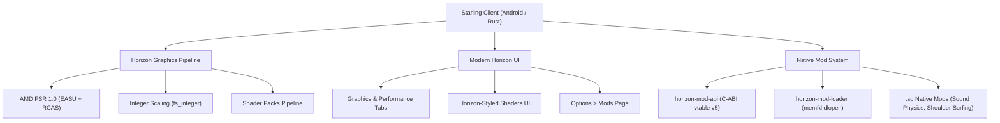

# Starling Project Status & Roadmap

**Repository:** `beyondbday69/starling`  
**Current Active Branch:** `feat/shader-fsr-upscaling`  
**Target Platform:** Android (ARM64 `arm64-v8a`)  
**Last Updated:** November 2026

---

## 1. Project Overview & Architecture

Starling is an optimized Minecraft client written in Rust (based on Horizon), targeted at Android devices. The project focuses on high performance, modern graphics pipeline capabilities, native Android UI/UX, and an extensible native modding ecosystem.

---

## 2. Progress: What Has Been Done

### Phase 1: AMD FSR 1.0 & CAS Spatial Upscaling
- **WGSL Shader Implementation:**
  - Implemented 12-tap Lanczos-approximated **EASU** in `crates/horizon-client-render/src/gfx/fsr.wgsl`.
  - Implemented contrast-adaptive **RCAS**.
  - Resolved Vulkan/Android NDC inversion by binding screen-space `@builtin(position).xy` directly to texel fetch coordinates via `textureLoad`.
- **Pipeline Integration:**
  - Integrated `FsrPipeline` into `crates/horizon-client-render/src/gfx/fsr.rs` and `pack_post.rs`.
  - Added resolution scaling presets (**Performance 50%**, **Balanced 67%**, **Quality 75%**, **Off 100%**) and sharpness controls into Horizon's menus.
- **CI / CD Android Release:**
  - Configured GitHub Actions workflow (`android.yml`) to build, sign with release keystore, and publish 64-bit release APKs.

### Phase 2: Integer Scaling & Horizon Shaders UI
- **Modernized Shader Pack Menus:**
  - Redesigned `Page::ShaderPacks`, `Page::ShaderOptions`, and `Page::NativePackOptions` in `crates/horizon-client-render/src/options_ui.rs`.
  - Brought Horizon's sleek modern UI design tokens to all shader configuration screens.
- **True Integer Scaling (`ShaderUpscaling::Integer`):**
  - Added integer multiplier mode `min(dst_w / src_w, dst_h / src_h)` for nearest-neighbor pixel-art rendering.
  - **180° Screen Flip Fix:** Eliminated fragile UV matrix inversions by routing integer scaling through the upright FSR coordinate space.

### Phase 3: Runtime `.so` Mod Loader Integration
- **Merged `origin/mod-loader` into `feat/shader-fsr-upscaling`:**
  - Finalized merge with 0 conflicts (commit `6246c88`).
  - Architecture: loads `lib*.so` on Android using anonymous memory file descriptor (`memfd_create` + `android_dlopen_ext`) to bypass SELinux restrictions without client rebuilds.

### Phase 4: Camera ABI v5, Crosshair & Shoulder Surfing Mod
- **ABI Extension (`horizon-mod-abi` v5):**
  - Added `CameraOffset` struct (`active`, `crosshair`, `right`, `up`, `forward`, `distance`).
  - Added `camera_offset` callback to `ModDesc`.
- **Client & Loader Hook Integration:**
  - Implemented `loader::camera_offset` in `crates/horizon-mod-loader/src/lib.rs`.
  - Exposed `mod_loader::camera_offset` in `crates/horizon-client/src/game/mod_loader.rs`.
  - Wired into third-person camera calculation in `crates/horizon-client/src/game/perspective.rs` with automated block collision detection and distance clamping (`clip_world`).
- **Aiming Crosshair (+) Support in Third Person:**
  - In vanilla Minecraft and Horizon, third-person perspective completely hides the crosshair (`+`).
  - Added support in `game.rs` to render the aiming crosshair (`+`) and attack indicators in third person when Shoulder Surfing is active.
- **`horizon-mod-shouldersurfing` Implementation:**
  - Created `crates/horizon-mod-shouldersurfing` (cdylib producing `libshouldersurfing.so`).
  - Full feature set:
    - Adjustable shoulder offsets (Right +0.75 / Left -0.75 / Center 0.0).
    - Adjustable vertical height and camera distance.
    - Smooth camera transitions with partial-tick interpolation.
    - Dynamic wall collision avoidance via `host.raycast`.
    - Aiming Crosshair (+) toggle in settings.
    - Settings persistence using `host.setting()` / `host.set_setting()`.
    - Interactive Options > Mods configuration page.
- **CI / CD Automation:**
  - Updated `.github/workflows/mod-loader.yml` to compile `horizon-mod-shouldersurfing` for ARM64 (`arm64-v8a`), package artifacts, and create releases.
  - Updated `.github/workflows/mod-checks.yml` for scoped formatting, clippy, and unit tests.

### Phase 5: Dynamic Eyes, Blinking, Look Tracking & Blushing (`libeyemod.so`)
- **ABI Extension (`horizon-mod-abi` v6):**
  - Added `PlayerEyes` struct (`active`, `blink`, `look_x`, `look_y`, `blush`, `expression`, `has_face_patch`, `face_pixels: [u32; 64]`).
  - Added `player_eyes: Option<unsafe extern "C" fn(f32, *mut PlayerEyes)>` to `ModDesc`.
- **Client & Loader Hook Integration:**
  - Added `player_eyes` in `crates/horizon-mod-loader/src/lib.rs` and `crates/horizon-client/src/game/mod_loader.rs`.
  - Added real-time 8x8 GPU atlas face patch upload (`map_patches`) in `crates/horizon-client/src/game/native_hooks.rs`.
- **`crates/horizon-mod-eyemod` Implementation (`libeyemod.so`):**
  - Tailored to user's anime ruby/wine-red eye skin (`#6d2337`/`#a8525b` irises, `#d3b2bd`/`#fffafb` catchlights, `#380f17` lash line).
  - Procedural blinking with natural intervals, duration, and random double-blinks.
  - Camera/head rotation look tracking (pupils shift left/right/up/down when turning).
  - Blushing feature with 5 modes: Off, Soft Pink, Rosy (Cute), Intense, and Reactive (crouching/low HP).
  - Configurable settings in Options > Mods.
- **CI / CD Automation:**
  - Added `horizon-mod-eyemod` to `.github/workflows/mod-loader.yml` for ARM64 compilation and GitHub Release publication.

---

## 3. Current Status & Verification

| Component | Status | Verification |
|---|---|---|
| **Merge `mod-loader`** | Complete | Commit `6246c88` committed |
| **Camera ABI Extension** | Complete | `cargo test -p horizon-mod-abi` passed |
| **Crosshair Aiming (+)** | Complete | Verified in `game.rs` |
| **Shoulder Surfing Mod** | Complete | `libshouldersurfing.so` published |
| **Player Eyes ABI v6** | Complete | `cargo test -p horizon-mod-abi` & `loader` passed (12/12) |
| **Dynamic Eyes & Blush Mod** | Complete | `crates/horizon-mod-eyemod` built with 0 warnings |
| **CI Automation** | Complete | `mod-loader.yml` & `mod-checks.yml` updated |

---

## 4. Next Steps
1. Push changes to `feat/shader-fsr-upscaling`.
2. GitHub Actions compiles `libeyemod.so` and the updated Android APK.
3. Install `libeyemod.so` in `horizon-native-mods/eyemod/` on Android.
4. Enjoy dynamic animated eyes, look tracking, and cute blushing in-game!
