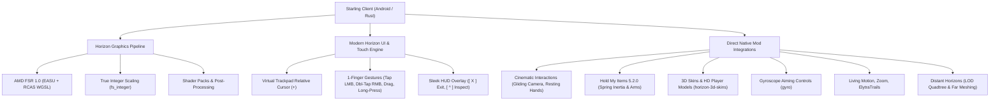

# Starling Project Status & Complete Context

**Repository:** `beyondbday69/starling`  
**Current Active Branch:** `feat/shader-fsr-upscaling`  
**Target Platform:** Android (ARM64 `arm64-v8a`)  
**Latest Commit:** `2a12825` (`feat(distant_horizons): add shader far distance, HUD progress bar, and pre-generation commands`)  
**Latest Successful CI Run:** `#45044632777` (Artifact: `14762698492`, size: 35.3 MB)  
**Last Updated:** November 2026  

---

## 1. Project Architecture & System Overview

Starling is an optimized, high-performance Minecraft client built in Rust (based on the Horizon engine) tailored specifically for Android. It features custom graphics pipelines, direct all-in-one native mod compilation into the core Android shared library (`libhorizon_android.so`), seamless touch gestures, virtual trackpad aiming, and cinematic in-world crafting interactions.

---

## 2. Full Implementation History & Phases

### Phase 1: AMD FSR 1.0 & CAS Spatial Upscaling
* **WGSL Shader Implementation:**
  * Implemented 12-tap Lanczos-approximated **EASU** in `crates/horizon-client-render/src/gfx/fsr.wgsl`.
  * Implemented contrast-adaptive **RCAS**.
  * Resolved Vulkan/Android NDC inversion by binding screen-space `@builtin(position).xy` directly to texel fetch coordinates via `textureLoad`.
* **Pipeline Integration:**
  * Integrated `FsrPipeline` into `crates/horizon-client-render/src/gfx/fsr.rs` and `pack_post.rs`.
  * Added resolution scaling presets (**Performance 50%**, **Balanced 67%**, **Quality 75%**, **Off 100%**) and sharpness controls into Horizon's menus.

### Phase 2: Integer Scaling & Modern Shaders UI
* **Modernized Shader Pack Menus:** Redesigned `Page::ShaderPacks`, `Page::ShaderOptions`, and `Page::NativePackOptions` in `crates/horizon-client-render/src/options_ui.rs`.
* **True Integer Scaling (`ShaderUpscaling::Integer`):** Added integer multiplier mode `min(dst_w / src_w, dst_h / src_h)` for crisp pixel-art rendering. Routed integer scaling through the upright FSR coordinate space to prevent 180° screen flipping.

### Phase 3: Runtime `.so` Mod Loader Integration
* Dynamic `.so` loader on Android utilizing anonymous memory file descriptors (`memfd_create` + `android_dlopen_ext`) to bypass SELinux restrictions without client rebuilds.

### Phase 4: Camera ABI v5, Crosshair & Shoulder Surfing Mod
* Added `CameraOffset` struct and `camera_offset` callback in `horizon-mod-abi` (v5).
* Wired into third-person camera calculation with block collision detection (`clip_world`).
* Enabled aiming crosshair (`+`) and attack indicators in third person.

### Phase 5: Dynamic Eyes, Smooth Blinking & Look Tracking
* Added `PlayerEyes` struct in `horizon-mod-abi` (v6) with real-time GPU atlas patching (`update_mod_player_eyes`).
* Continuous sub-pixel blinking ($\sin^2(\pi \cdot \tau)$), smooth eye tracking with exponential smoothing filter, downward eyelid droop, and continuous blushing.

### Phase 6: Resizable Eyes & Reactive Expressions (`libeyemod.so`)
* Eye scales: Normal (2x2), Tall/Big (2x3), Wide (3x2), Huge Anime (3x3), and Auto Dynamic.
* Reactive Shock Reaction: Triggers on damage taken or fast fall; eyes pop open, eyebrows arch, pupils jitter with micro-tremor, anime sweat drop on temple, open 'o' mouth.

### Phase 7: Hold My Items Core Integration (Direct APK Compilation)
* Direct port of the HMI 5.2.0 engine into `crates/horizon-client/src/game/holdmyitems/`:
  * 12 easing curves, $4\times4$ matrix transforms, spring-damper inertia physics, alternating sword combo slashes, per-item swing speed tables, and weapon inspection (`C` key 360° spin).
  * Direct hook injections into `totem.rs`, `hand.rs`, and `native_hooks.rs`.
  * All bundled assets embedded via `native_data!`, completely eliminating dynamic dlopen issues on Android.

### Phase 8: Core Mods Suite (Zoom, ElytraTrails, Living Motion)
* **Zoom (`zoom.rs`):** Built-in smooth camera zoom with sensitivity scaling.
* **ElytraTrails (`elytratrails/`):** Dynamic fading wingtip contrails with LAN color synchronization.
* **Living Motion (`livingmotion/`):** Dynamic procedural animation rig (swings, leaning, jumping, banking, swimming, climbing).

### Phase 9: Horizon 3D Skins & Gyro Native Mods Integration (`03e97f9`, `ff69d2f`)
* **3D Skins (`umbx-dot/horizon-3d-skins`):** Integrated layered 3D skin geometry, extruded clothing/armor layers, and HD skin rendering. Resolved `studio` field visibility and mutable borrow conflicts.
* **Gyro Aiming (`CGRLabs/gyro`):** Integrated device gyroscope motion sensing for fine-tuned tilt aiming and camera orientation on Android.

### Phase 10: Virtual Trackpad Cursor & 1-Finger Crafting (`25802d5`, `218f825`, `b9cd04b`)
* **Virtual Trackpad Cursor:**
  * Replaced jumpy direct-touch input with a smooth relative trackpad cursor. Swiping anywhere on the screen moves the in-world `+` crosshair cursor smoothly across workstation slots.
* **1-Finger Gesture Engine (`touch_helper.rs`):**
  * **Single Tap:** Left-Click (`inventory_press(false)`) — picks up or places a stack of items.
  * **Double Tap:** Right-Click (`inventory_press(true)`) — places 1 single item or splits a stack in half.
  * **Double-Tap & Drag:** Right-Click Drag — distributes 1 item across each slot dragged over (row crafting).
  * **Long Press:** Quick-Move (Shift + Left-Click) — transfers stack immediately to/from inventory.
* **HUD Overlay:**
  * Sleek `[ X ]` exit button in the top right to close workstation interactions cleanly.
  * Sleek `[ ^ ]` inspect/toggle button.
  * Real-time 3D item drag preview floating with the cursor.

### Phase 11: Workstation Crash & Deadlock Fix (`34a0af2`, Run `#44355584017`)
* **The Problem:** Game froze or crashed instantly upon opening/interacting with a crafting table or workstation.
* **Root Causes Identified & Fixed:**
  1. **Recursive Mutex Deadlock:** `ci::vcursor` locked the global `STATE` mutex and invoked `default_aim_point(w, h)`, which internally called `table()`, which attempted to re-lock `STATE` on the same thread. Rust's `std::sync::Mutex` is not re-entrant, causing an immediate deadlock.
     * *Fix:* Created `aim_point_from_state(&State, w, h)` to project aim points directly from the already-borrowed `State` without re-locking.
  2. **Render Pass Mutation:** `draw_inventory` GPU render pass was invoking `inventory_press`, mutating game state while wgpu rendering was in flight.
     * *Fix:* Removed all inventory mutation from rendering code; moved pending tap execution cleanly into the engine frame hook (`Game::frame`).
  3. **Touch Safety Guard:** Added state validation in `touch_helper.rs`:
     `if !ci::controls() || game.screen != Screen::Inventory || ci::walking(Instant::now()) { return ControlFlow::Continue(()); }`
* **Verification:** GitHub Actions Run `#44355584017` completed with status **SUCCESS**.

---

## 3. Implemented Feature: Option 1 - "Mouse Tweaks" Sweep Drag to Collect Matching Items

### The User Request:
> *"Now can I grab all items at one's like sab scattered hai and muje sab ek hand me lena hai same item ? Just answer that"*  
> *"Toh right click kaise rakhenge just reply"*

### Implementation Details:
* **Feature:** 'Mouse Tweaks' style sweep drag collection (`Input::PickupAll`).
* **Behavior:** When the player is holding an item stack (`game.carried.is_some()`) and sweeps the virtual trackpad cursor across the inventory without active RMB crafting drag:
  * Detects hovered slot via `inventory_target()`.
  * If the slot contains matching items (`target.item == held.item`) and the cursor stack is not full (`held.count < 64`):
    * Triggers `game.menu_click(Some(slot), 0, Input::PickupAll)`.
    * Plays click sound `game.audio.play_button_click()`.
    * Marks container changed `game.container_changed(key)`.
  * Tracks `last_swept_slot: Option<usize>` in `TouchState` to prevent repeated rapid clicks on the same cell during cursor movement.
  * Preserves existing Double-Tap & Drag for RMB crafting and `[ X ]` / `[ ^ ]` HUD buttons.

---

## 3.1. 3D Skins Native Mod Flat Outer Layers Fix
* **Problem:** Outer skin layers (hat, jacket, sleeves, pants) rendered flat on Android devices.
* **Fixes Applied:**
  * Added `from_atlas()` in `glue.rs` to extract default player skin pixels directly from `game.gui.atlas.pixels()`.
  * Resolved `horizon/own_skin` and `horizon/offline_skin` directly from `game.own_skin.image` and `horizon_client::skins::offline_skin()`.
  * Prevented dynamic skin locations from being blacklisted in `MISSING`.
  * Fixed `render_visible()` in `crates/horizon-client/src/mobs/render.rs` so `m.skin_3d` is not overridden by CEM custom body models.
  * Added dynamic model cache invalidation in `cache.rs` on RGBA change.
  * Added logcat tracing for resolution steps and mod initialization.

---

## 3.2. Falling Trees 3D Toppling Animation
* **Goal:** Direct response to user feedback *"why there's is no animation for falling tree tree just breaks apart instantly without any animation fix it man"*.
* **Implementation:**
  * **Dynamic Topple Vector:** Calculates horizontal topple trajectory directed away from the chopping player.
  * **Zero Ghosting:** Immediately clears chunk terrain blocks and replaces them with an animated 3D multi-block structure.
  * **Realistic 3D Topple Physics:** Accelerates under gravity ($\theta(t) \propto t^2$) with full 3D block model rendering, ambient occlusion, world lighting, and leaf biome tints.
  * **Impact Landing:** On ground impact, plays heavy crash audio, bursts LevelEvent 2001 wood/leaf particles across landing coordinates, spawns all loot drops cleanly at the stump, and wears held axe durability.
  * **Borrow & Scope Safety:** Cloned held item stack before `block_drops` loop and accessed player coordinates via `self.player`.

---

## 3.3. Distant Horizons Native Mod Integration (`34d8186`, `2a12825`)
* **Goal:** Bring high-performance Level-of-Detail (LOD) distant terrain rendering past standard render distance directly into Starling on Android, with full shader support, live progress HUD, and background pre-generation commands.
* **Ported & Packaged:** Ported from `denizsahin7744/distant-horizons-for-horizon-client` (v0.1.0) into `native-mods/distant_horizons/`.
* **Key Features:**
  * **Quadtree Detail Plan:** Chunks converted into column runs and hierarchically propagated up to 16,384-block wide sections.
  * **Distant Generation:** Background procedural sampling from world generator for unvisited sections.
  * **Far-Terrain Meshing & Culling:** Top/bottom and adjacent column occlusion culling, coplanar face merging, and cave culling.
  * **Shader Pack Compatibility & Fog Scaling:** In `game.rs`, scaled `detail_distance` to full LOD terrain boundary `(self.terrain_distance() * 16)` and activated `distant_terrain` fog flag in `render_tick.rs`. Shaders (e.g. Complementary Reimagined) render distant terrain without fog drowning or clipping.
  * **Live HUD Progress Bar:** Compact 165×24px progress card at bottom-left showing percentage, section count (`{shown}/{wanted}`), chunk count, and colored progress fill (blue while loading, emerald on completion). Configurable via Options menu and `/dh bar [while_loading|always|off]`.
  * **Pre-Generation Commands:** Added `/dh startgen` and `/dh stopgen` to batch-queue unmeshed sections in the LOD radius and wake background worker threads. Updated `/dh status` to report live loaded percentage.
  * **Unit Tests & All-In-One APK:** 15/15 unit tests passed; built into `libhorizon_android.so` alongside all core and mixin mods.

---

## 4. Key Artifacts, Releases & Action Runs

| Run ID | Commit | Description | Artifact ID / Download | Status |
|---|---|---|---|---|
| **#45044632777** | `2a12825` | **Distant Horizons Shader Support, Live Progress Bar & Pre-Generation (`/dh startgen`):** Far distance uniform & fog scaling for shaders, live HUD progress card with percentage/section readout, `/dh startgen` & `/dh stopgen` pre-generation commands, and full native mods suite (`starling-preview-0.8.0-arm64-v8a.apk`) | [Artifact 14762698492](https://github.com/beyondbday69/starling/actions/runs/45044632777/artifacts/14762698492) | **PASSED (Green)** |
| **#45038706589** | `34d8186` | **Distant Horizons Native Mod (v0.1.0) + Full Native Mods Suite:** Ported Distant Horizons level-of-detail terrain (quadtree detail plans, section meshing, distant generation, cave culling, in-game options & /dh chat commands) built directly into Android APK (`starling-preview-0.8.0-arm64-v8a.apk`) | [Artifact 14760659097](https://github.com/beyondbday69/starling/actions/runs/45038706589/artifacts/14760659097) | **PASSED (Green)** |
| **#45027183002** | `c827585` | **Falling Trees 3D Toppling Animation + Full Native Mods:** Added dynamic topple vector away from player, gravity angular acceleration, full 3D rotating block model rendering with world lighting & biome tints, ground impact audio, LevelEvent 2001 break particles, and clean drop spawning (`starling-preview-0.8.0-arm64-v8a.apk`) | [Artifact 14756228477](https://github.com/beyondbday69/starling/actions/runs/45027183002/artifacts/14756228477) | **PASSED (Green)** |
| **#44931937290** | `72e3db2` | **Latest 33MB Single APK Build:** Single APK Output (~33MB zip / 35MB APK) + All Core Mods in Manifest (`holdmyitems`, `zoom`, `elytratrails`, `livingmotion`) + Mixin Mods (`cinematic_interactions`, `skins_3d`, `gyro`) + Left-Side [LMB]/[RMB] Hold & Right-Side Drag Buttons | [Artifact 14717714264](https://github.com/beyondbday69/starling/actions/runs/44931937290/artifacts/14717714264) | **PASSED (Green)** |
| **#44928400353** | `6408c69` | Cinematic Interactions (Left-Side LMB/RMB Hold & Right-Side Drag Buttons) + All Native Mods (`cinematic_interactions`, `skins_3d`, `gyro`, `holdmyitems`, `zoom`, `livingmotion`, `elytratrails`) + Enchanted Tool Outlines & Section 11 Mining Cadence (Duplicated APK in artifact: 70.4 MB) | [Artifact 14716584831](https://github.com/beyondbday69/starling/actions/runs/44928400353/artifacts/14716584831) | PASSED |
| **#44924392350** | `5cf85b3` | Hold My Items Mining Cadence (Section 11 HMI 5.1.3 reference: half-duration restart, 6-tick cap, zero idle lag) + Canonical Pickaxe/Bare Hand poses + Enchanted Tool Outlines (GUI & 3D first-person) | [Artifact 14715600991](https://github.com/beyondbday69/starling/actions/runs/44924392350/artifacts/14715600991) | PASSED |
| **#44915271892** | `9b1aa18` | Hold My Items Continuous Mining + Enchanted Tool Outlines (GUI & 3D first-person) | [Artifact 14711966825](https://github.com/beyondbday69/starling/actions/runs/44915271892/artifacts/14711966825) | PASSED |
| **#44464049499** | `dcf4245` | 3D Skins Real Voxels Fix (Atlas Extraction + In-Memory Own Skin + CEM Override Prevention) + Screen-Split Touch Controls + Cinematic Interactions + Gyro | [Artifact 14501069325](https://github.com/beyondbday69/starling/actions/runs/44464049499/artifacts/14501069325) | PASSED |
| **#44408523280** | `0faef7a` | Screen-Split LMB/RMB Controls + Action Text Indicator + Cinematic Interactions + 3D Skins + Gyro | [Artifact 14475234256](https://github.com/beyondbday69/starling/actions/runs/44408523280/artifacts/14475234256) | PASSED |
| **#44395053407** | `e35ea8e` | Sweep Drag + Cinematic Interactions + 3D Skins + Gyro | [Artifact 14472020982](https://github.com/beyondbday69/starling/actions/runs/44395053407/artifacts/14472020982) | PASSED |
| **#44389836599** | `e35ea8e` | Option 1 Sweep Drag item collection (plain build) | [Artifact 14469510477](https://github.com/beyondbday69/starling/actions/runs/44389836599/artifacts/14469510477) | PASSED |
| **#44355584017** | `34a0af2` | Fixed deadlock crash, safe frame tap, trackpad cursor | [Artifact 14452912493](https://github.com/beyondbday69/starling/actions/runs/44355584017/artifacts/14452912493) | PASSED |
| **#44339845300** | `25802d5` | Added virtual trackpad cursor and 1-finger gestures | [Artifact 14449830847](https://github.com/beyondbday69/starling/actions/runs/44339845300) | PASSED |
| **#44175839634** | `df94b42` | Hold My Items + Zoom + ElytraTrails + Living Motion All-In-One | [Artifact 14371345303](https://github.com/beyondbday69/starling/actions/runs/44175839634) | PASSED |
| **Release** | `58c43de` | `libeyemod.so` (Eye tracking, blink, shock reaction) | [Release `mod-loader-eyemod`](https://github.com/beyondbday69/starling/releases/tag/mod-loader-eyemod) | Published |
| **Release** | `58c43de` | `libshouldersurfing.so` (Third person camera & crosshair) | [Release `mod-loader-shouldersurfing`](https://github.com/beyondbday69/starling/releases/tag/mod-loader-shouldersurfing) | Published |

---

## 5. Important Guidelines for Next Session
1. **Repository Path:** `/root/starling`
2. **Target Branch:** `feat/shader-fsr-upscaling`
3. **VPS Memory Limit:** VPS has only 2GB RAM. **Never run `cargo build` locally** on the VPS. Always build via GitHub Actions workflow (`workflow_dispatch` on `android.yml`).
4. **Git Remote Operations:** Always use `BypassSandbox: true` when running `gh` commands.
