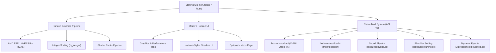

# Starling Project Status & Roadmap

**Repository:** `beyondbday69/starling`  
**Current Active Branch:** `feat/shader-fsr-upscaling`  
**Target Platform:** Android (ARM64 `arm64-v8a`)  
**Latest Commit:** `58c43de`  
**Last Updated:** November 2026  

---

## 1. Project Overview & Architecture

Starling is an optimized Minecraft client written in Rust (based on Horizon), targeted at Android devices. The project focuses on high performance, modern graphics pipeline capabilities, native Android UI/UX, and an extensible native runtime modding ecosystem.

---

## 2. Progress: What Has Been Done

### Phase 1: AMD FSR 1.0 & CAS Spatial Upscaling
- **WGSL Shader Implementation:**
  - Implemented 12-tap Lanczos-approximated **EASU** in `crates/horizon-client-render/src/gfx/fsr.wgsl`.
  - Implemented contrast-adaptive **RCAS**.
  - Resolved Vulkan/Android NDC inversion by binding screen-space `@builtin(position).xy` directly to texel fetch coordinates via `textureLoad`.
- **Pipeline Integration:**
  - Integrated `FsrPipeline` into `crates/horizon-client-render/src/gfx/fsr.rs` and `pack_post.rs`.
  - Added resolution scaling presets (**Performance 50%**, **Balanced 67%**, **Quality 75%**, **Off 100%**) and sharpness controls into Horizon's menus.
- **CI / CD Android Release:**
  - Configured GitHub Actions workflow (`android.yml`) to build, sign with release keystore, and publish 64-bit release APKs.

### Phase 2: Integer Scaling & Horizon Shaders UI
- **Modernized Shader Pack Menus:**
  - Redesigned `Page::ShaderPacks`, `Page::ShaderOptions`, and `Page::NativePackOptions` in `crates/horizon-client-render/src/options_ui.rs`.
  - Brought Horizon's sleek modern UI design tokens to all shader configuration screens.
- **True Integer Scaling (`ShaderUpscaling::Integer`):**
  - Added integer multiplier mode `min(dst_w / src_w, dst_h / src_h)` for nearest-neighbor pixel-art rendering.
  - **180° Screen Flip Fix:** Eliminated fragile UV matrix inversions by routing integer scaling through the upright FSR coordinate space.

### Phase 3: Runtime `.so` Mod Loader Integration
- **Merged `origin/mod-loader` into `feat/shader-fsr-upscaling`:**
  - Architecture: loads `lib*.so` on Android using anonymous memory file descriptor (`memfd_create` + `android_dlopen_ext`) to bypass SELinux restrictions without client rebuilds.

### Phase 4: Camera ABI v5, Crosshair & Shoulder Surfing Mod
- **ABI Extension (`horizon-mod-abi` v5):**
  - Added `CameraOffset` struct (`active`, `crosshair`, `right`, `up`, `forward`, `distance`).
  - Added `camera_offset` callback to `ModDesc`.
- **Client & Loader Hook Integration:**
  - Implemented `loader::camera_offset` in `crates/horizon-mod-loader/src/lib.rs`.
  - Exposed `mod_loader::camera_offset` in `crates/horizon-client/src/game/mod_loader.rs`.
  - Wired into third-person camera calculation in `crates/horizon-client/src/game/perspective.rs` with automated block collision detection and distance clamping (`clip_world`).
- **Aiming Crosshair (+) Support in Third Person:**
  - Enabled aiming crosshair (`+`) and attack indicators in third person when Shoulder Surfing is active.
- **`horizon-mod-shouldersurfing` Implementation:**
  - Full third-person offset controls, camera collision avoidance, and Options > Mods configuration.
  - Published to GitHub Releases (`mod-loader-shouldersurfing`).

### Phase 5: Dynamic Eyes, Smooth Blinking, Look Tracking & Blushing
- **ABI v6 Engine Interface (`horizon-mod-abi`):**
  - Added `PlayerEyes` struct (264 bytes: `active`, `blink`, `look_x`, `look_y`, `blush`, `expression`, `has_face_patch`, `face_pixels: [u32; 64]`).
  - Added `player_eyes` callback to `ModDesc`.
- **Client GPU Atlas Real-Time Patching:**
  - In `crates/horizon-client/src/game/native_hooks.rs`, implemented `update_mod_player_eyes` to upload `face_pixels` directly to `self.map_patches` in the player skin's head front slot on the GPU atlas every frame.
- **Sub-Pixel Continuous Smoothing:**
  - **Smooth Blinking:** Replaced discrete 3-stage blink with continuous float coverage $y_{\text{lid}} \in [0.0, 2.0]$ driven by $\sin^2(\pi \cdot \tau)$. Eyelid sweeps across sub-pixel boundaries from iris/sclera through dark lash line into eyelid skin.
  - **Smooth Look Tracking:** Exponential smoothing filter tracks camera rotation smoothly; continuous sub-pixel color blending (`lerp_u32`) glides pupils across columns.
  - **Downward Eyelid Droop:** Looking down applies natural organic eyelid droop.
  - **Smooth Blushing:** Continuous alpha blending fades cheek blush in and out seamlessly.

### Phase 6: Resizable Eye Scales & Reactive Shock Expressions (`libeyemod.so` v1.1)
- **Eye Resizing System:**
  - **Normal (2x2)**: Standard 2-row anime eye (rows 5 & 6).
  - **Tall / Big (2x3)**: 3-row tall expressive anime eyes (rows 4, 5, 6). Eyelash line opens upward and eyebrows arch high on row 3 (forehead).
  - **Wide (3x2)**: 3-column wide cute eyes expanding into columns 3 & 4.
  - **Huge Anime (3x3)**: 3-row tall and 3-column wide massive expressive anime eyes.
  - **Auto Dynamic (Reactive)**: Smoothly resizes eye scale dynamically based on sprinting, speed, camera turn, and active reactions.
  - **Multi-Row Eyelid Physics:** Generalized `apply_eyelid_dynamic` supporting seamless continuous blinking across 2-row and 3-row heights without artifacts.
- **Reactive Expressions:**
  - **Anime Shock Reaction ("Big Eyes"):**
    - Automatically triggered on damage taken (`health < last_health`) or fast falling (`vy < -0.45`).
    - Eyes instantly pop open wide into **Big 3-row tall eyes**.
    - Eyebrows raise high onto forehead.
    - Startled contracted pupils with rapid micro-tremor jitter ($\sin(35t)$).
    - Classic anime blue sweat drop on temple (`#48dbfb`).
    - Surprised open `'o'` mouth on chin (`#380f17`).
    - Smooth 2.2-second duration with natural ease-out return.
  - **Squint / Narrowed:** Sleek focused narrow slit gaze when crouching/sneaking (`Shift`).
  - **Happy (^ ^):** Cheerful upward crescent lashes with extra rosy blush.
  - **Sparkle (* *):** Golden star catchlights when holding diamonds, emeralds, golden apple, or totem.
  - **Hurt / Low HP:** Glossy teary half-lidded eyes with heavy blush under 3 hearts.
- **Options > Mods Configuration:**
  - 6 configurable options: Blinking, Eye Tracking, Eye Size, Expression (with preview modes), Blushing, Blink Frequency.
- **Build & CI / CD Fixes:**
  - Fixed `clippy::inherent_to_string_shadow_display` in `crates/horizon-client-render/src/graphics.rs`.
  - ARM64 `libeyemod.so` compiled and published to GitHub Release `mod-loader-eyemod`.

---

## 3. Current Status & Verification

| Component | Status | Verification |
|---|---|---|
| **Merge `mod-loader`** | Complete | Commit `6246c88` committed |
| **Camera ABI Extension (v5)** | Complete | `cargo test -p horizon-mod-abi` passed |
| **Aiming Crosshair (+)** | Complete | Verified in `game.rs` |
| **Shoulder Surfing Mod** | Complete | `libshouldersurfing.so` published |
| **Player Eyes ABI v6** | Complete | 12/12 tests passed in abi & loader |
| **Android APK (ABI v6)** | Complete | Actions run `44032296640` passed |
| **Smooth Sub-pixel Blinking** | Complete | Continuous $\sin^2$ curve verified |
| **Smooth Look Tracking** | Complete | Continuous lerp & droop verified |
| **Resizable Eye Sizes** | Complete | 2x2, 2x3, 3x2, 3x3, auto dynamic verified |
| **Reactive Shock Reaction** | Complete | Damage/fall shock, sweat drop, mouth verified |
| **Interactive Mod Settings** | Complete | 6 Options > Mods rows active |
| **`libeyemod.so` Build** | Complete | Release `mod-loader-eyemod` updated |

---

## 4. Key Artifacts & Download Links

- **Latest `libeyemod.so` (Resizable Eyes & Shock Reactions):**  
  [Download `libeyemod.so`](https://github.com/beyondbday69/starling/releases/download/mod-loader-eyemod/libeyemod.so)  
  *(Release: [mod-loader-eyemod](https://github.com/beyondbday69/starling/releases/tag/mod-loader-eyemod))*

- **Shoulder Surfing Mod:**  
  [Download `libshouldersurfing.so`](https://github.com/beyondbday69/starling/releases/download/mod-loader-shouldersurfing/libshouldersurfing.so)  
  *(Release: [mod-loader-shouldersurfing](https://github.com/beyondbday69/starling/releases/tag/mod-loader-shouldersurfing))*

- **Android Client APK (ABI v6 with Face Patching):**  
  [Download `starling-apk-arm64-v8a`](https://github.com/beyondbday69/starling/actions/runs/44032296640)
