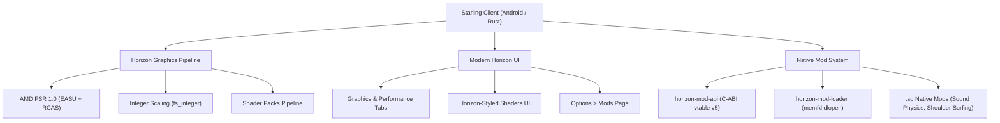

# Starling Project Status & Roadmap

**Repository:** `beyondbday69/starling`  
**Current Active Branch:** `feat/shader-fsr-upscaling`  
**Target Platform:** Android (ARM64 `arm64-v8a`)  
**Last Updated:** November 2026

---

## 1. Project Overview & Architecture

Starling is an optimized Minecraft client written in Rust (based on Horizon), targeted at Android devices. The project focuses on high performance, modern graphics pipeline capabilities, native Android UI/UX, and an extensible native modding ecosystem.

---

## 2. Progress: What Has Been Done

### Phase 1: AMD FSR 1.0 & CAS Spatial Upscaling
- **WGSL Shader Implementation:**
  - Implemented 12-tap Lanczos-approximated **EASU** (Edge-Adaptive Spatial Upsampling) in `crates/horizon-client-render/src/gfx/fsr.wgsl`.
  - Implemented contrast-adaptive **RCAS** (Robust Contrast-Adaptive Sharpening).
  - Resolved Vulkan/Android NDC inversion by binding screen-space `@builtin(position).xy` directly to texel fetch coordinates via `textureLoad`.
- **Pipeline Integration:**
  - Integrated `FsrPipeline` into `crates/horizon-client-render/src/gfx/fsr.rs` and `pack_post.rs`.
  - Added resolution scaling presets (**Performance 50%**, **Balanced 67%**, **Quality 75%**, **Off 100%**) and sharpness controls into Horizon's Performance & Graphics menus.
- **CI / CD Android Release:**
  - Configured GitHub Actions workflow (`android.yml`) to build, sign with release keystore, and publish 64-bit (`arm64-v8a`) release APKs.

### Phase 2: Integer Scaling & Horizon Shaders UI
- **Modernized Shader Pack Menus:**
  - Redesigned `Page::ShaderPacks`, `Page::ShaderOptions`, and `Page::NativePackOptions` in `crates/horizon-client-render/src/options_ui.rs`.
  - Brought Horizon's sleek modern UI design tokens (`graphics_style::VEIL`, `graphics_style::slider`, `graphics_style::button`, and `graphics_style::scroller`) to all shader configuration screens.
  - Added event triggers (`Event::ListShaderPacks`) directly when entering Graphics pages so shader lists populate instantly.
- **True Integer Scaling (`ShaderUpscaling::Integer`):**
  - Added integer multiplier mode `min(dst_w / src_w, dst_h / src_h)` for nearest-neighbor pixel-art rendering.
  - **180° Screen Flip Fix:** Eliminated fragile UV matrix inversions and hardware viewport flipping by implementing a dedicated `fs_integer` pass inside the FSR pipeline.
  - Verified with `cargo check -p horizon-client-render` and pushed commit `3a7fa84` (Build Run `43930766247` passed).

### Phase 3: Runtime `.so` Mod Loader Integration
- **Merged `origin/mod-loader` into `feat/shader-fsr-upscaling`:**
  - Resolved and finalized merge with 0 conflicts (commit `6246c88`).
  - Architecture: loads `lib*.so` on Android using anonymous memory file descriptor (`memfd_create` + `android_dlopen_ext`) to bypass SELinux restrictions without client rebuilds.
  - Includes `horizon-mod-abi`, `horizon-mod-loader`, `horizon-mod-hello`, and `horizon-mod-soundphysics`.

### Phase 4: Camera ABI v5 & Shoulder Surfing Mod
- **ABI Extension (`horizon-mod-abi` v5):**
  - Added `CameraOffset` struct (`active`, `right`, `up`, `forward`, `distance`).
  - Added `camera_offset: Option<unsafe extern "C" fn(f32, *mut CameraOffset)>` callback to `ModDesc`.
  - Unit tests updated and verified passing.
- **Client & Loader Hook Integration:**
  - Implemented `loader::camera_offset` in `crates/horizon-mod-loader/src/lib.rs`.
  - Exposed `mod_loader::camera_offset` in `crates/horizon-client/src/game/mod_loader.rs`.
  - Wired into third-person camera calculation in `crates/horizon-client/src/game/perspective.rs` with automated block collision detection and distance clamping (`clip_world`).
- **`horizon-mod-shouldersurfing` Implementation:**
  - Created `crates/horizon-mod-shouldersurfing` (cdylib producing `libshouldersurfing.so`).
  - Ported core Shoulder Surfing functionality:
    - Adjustable shoulder offsets (Right +0.75 / Left -0.75 / Center 0.0).
    - Adjustable vertical height and camera distance.
    - Smooth camera transitions with partial-tick interpolation.
    - Real-time block collision detection using `host.raycast` to prevent clipping into blocks.
    - Settings persistence using `host.setting()` / `host.set_setting()`.
    - Interactive Options > Mods configuration page.
- **CI / CD Automation:**
  - Updated `.github/workflows/mod-loader.yml` to compile `horizon-mod-shouldersurfing` for `arm64-v8a`, verify symbols, upload artifacts, and publish release.
  - Updated `.github/workflows/mod-checks.yml` for clippy and test coverage.

---

## 3. Current Status & Verification

| Component | Status | Verification |
|---|---|---|
| **Merge `mod-loader`** | Complete | Commit `6246c88` committed |
| **Camera ABI Extension** | Complete | `cargo test -p horizon-mod-abi` passed (4/4) |
| **Loader & Client Hook** | Complete | Wired with collision safety |
| **Shoulder Surfing Port** | Complete | `crates/horizon-mod-shouldersurfing` implemented |
| **CI `.so` Automation** | Complete | `mod-loader.yml` & `mod-checks.yml` updated |

---

## 4. Next Steps
1. Verify `cargo check -p horizon-mod-shouldersurfing`.
2. Commit all changes to `feat/shader-fsr-upscaling`.
3. Push to `origin feat/shader-fsr-upscaling`.
4. Trigger GitHub Actions CI build for APK and `.so` mods.
